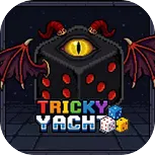
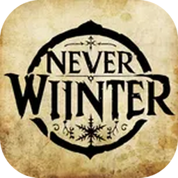
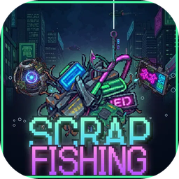

<a href="https://github.com/JungYS24/Tricky-Yacht"><picture><source media="(prefers-color-scheme: dark)" srcset="assets/github-dark.svg"></picture></a>&nbsp;&nbsp;&nbsp;
<a href="https://github.com/Windintosh/SCP_EXODUS"><picture><source media="(prefers-color-scheme: dark)" srcset="assets/github-dark.svg"></picture></a>&nbsp;&nbsp;&nbsp;
<a href="https://github.com/KimBH04/NeverWinter"><picture><source media="(prefers-color-scheme: dark)" srcset="assets/github-dark.svg"></picture></a>&nbsp;&nbsp;&nbsp;
<a href="https://github.com/Windintosh/EscapeTheOvertime"><picture><source media="(prefers-color-scheme: dark)" srcset="assets/github-dark.svg"></picture></a>&nbsp;&nbsp;&nbsp;
<a href="https://github.com/Windintosh/EscapeTheOvertimeVR"><picture><source media="(prefers-color-scheme: dark)" srcset="assets/github-dark.svg"></picture></a>&nbsp;&nbsp;&nbsp;
<a href="https://github.com/JungYS24/scrap-fishing"><picture><source media="(prefers-color-scheme: dark)" srcset="assets/github-dark.svg"></picture></a>

<a href="https://jungys24.github.io/JungYS24/">개발자 프로필 사이트로 가기</a>

